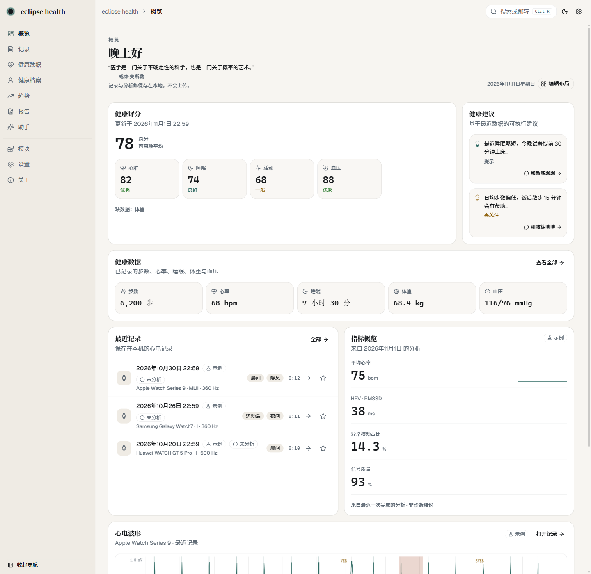
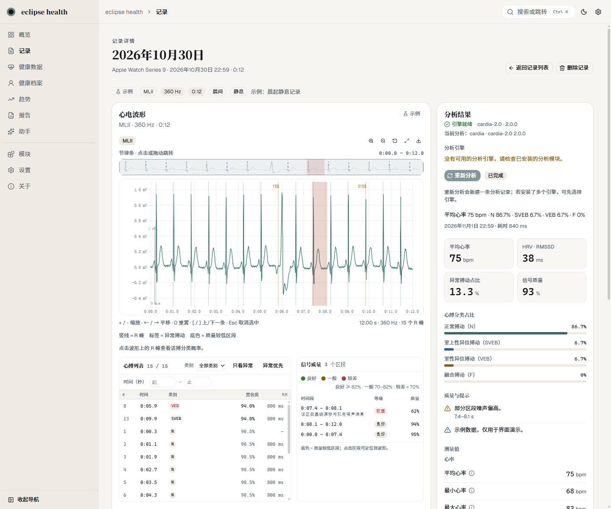
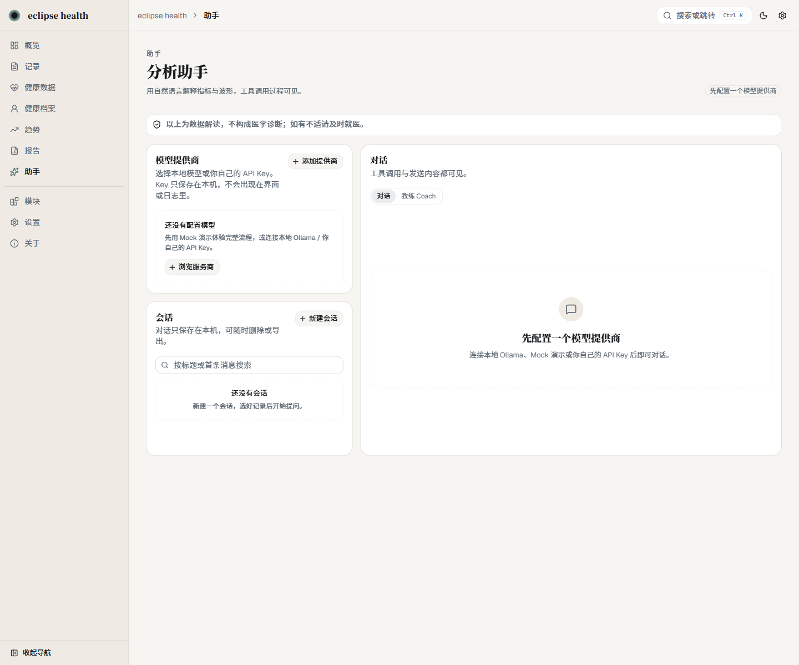
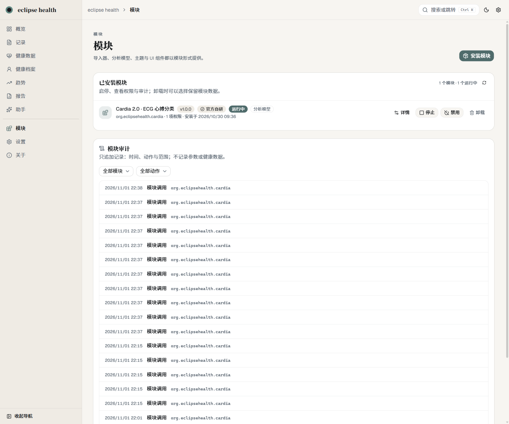
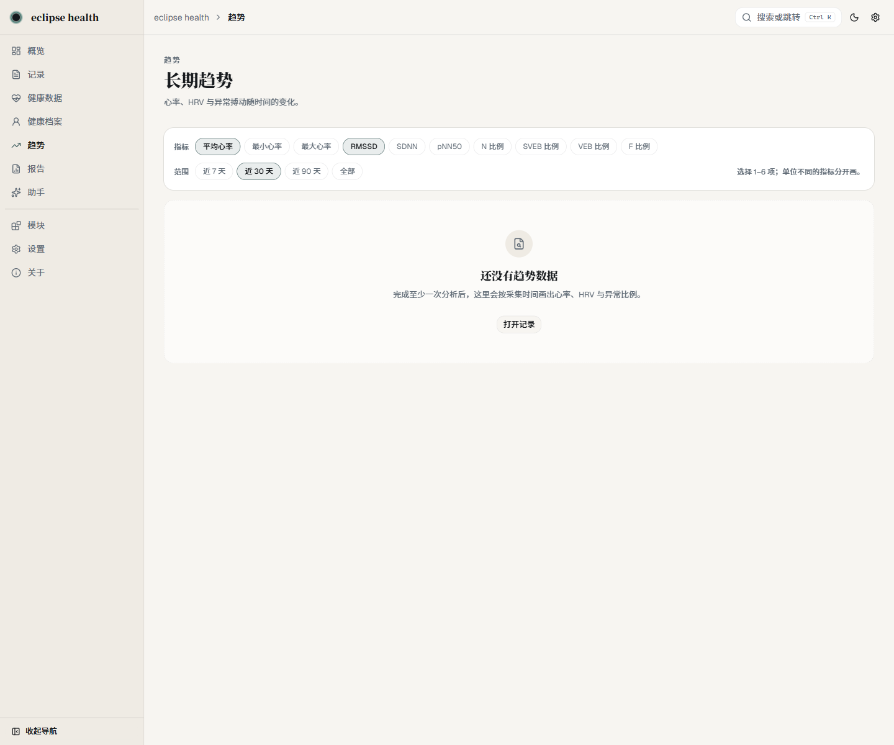
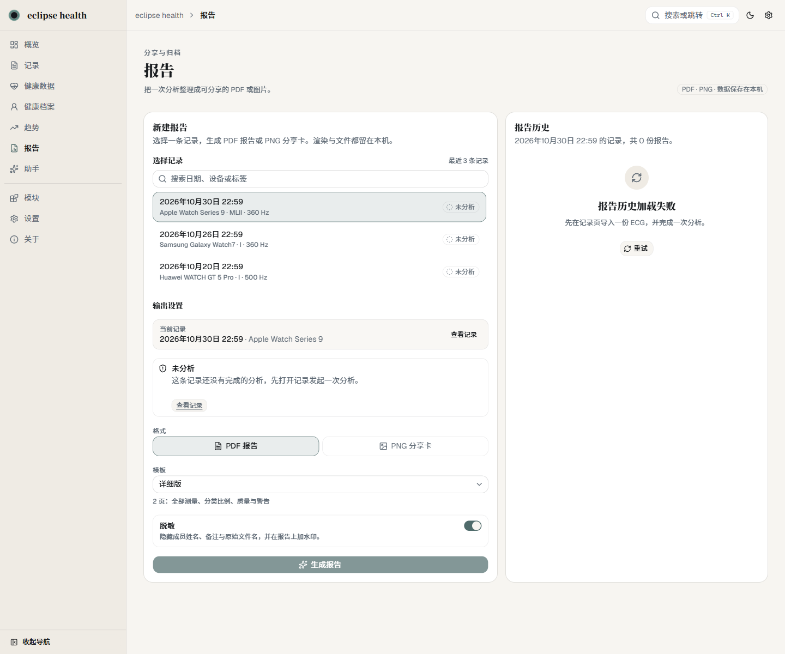
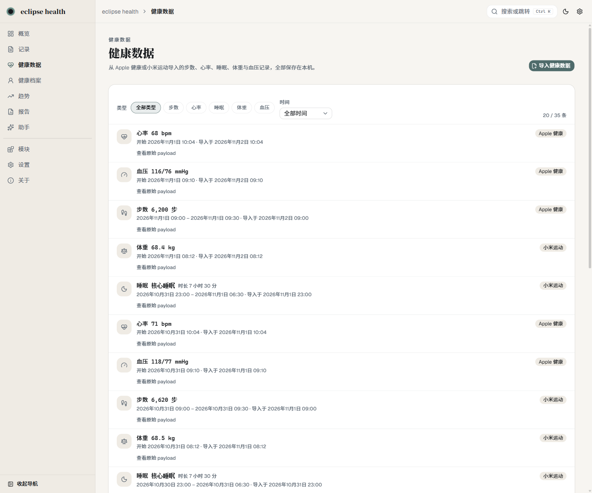
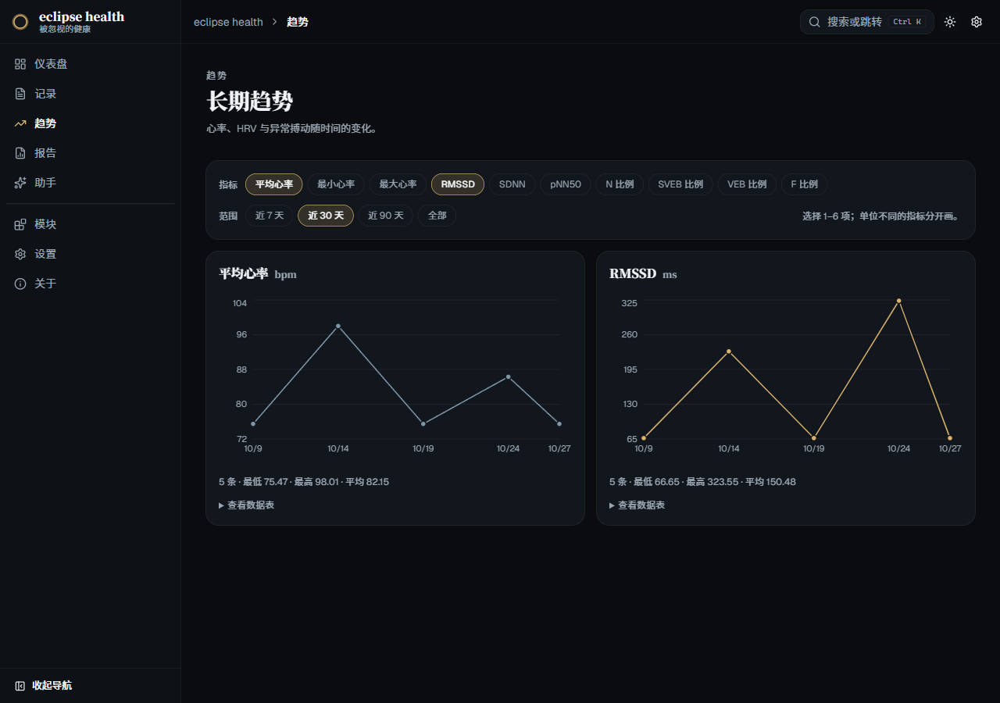

<div align="center">


# eclipse health

**Your health data, kept by you.**

A local-first, open-source desktop health hub: ECG analysis, health-data trends and report export — all on your machine.

[](LICENSE)
[](#install)
[](https://github.com/Muhan-Qiu/eclipse-health/releases)
[](#privacy-and-security)

[Website](https://eclipse-health.fit/) · [Modules](https://eclipse-health.fit/modules.html) · [Developer docs](https://eclipse-health.fit/developers.html) · [中文](README.zh-CN.md)

</div>

---

> **Status: `0.1.0-alpha`.** Windows 10/11 x64 only. The installer is not code-signed, so SmartScreen will show "Unknown publisher" — choose **More info → Run anyway**. Vendor watch formats are marked *experimental* until verified against real exports. See [Known limitations](#known-limitations).

## Why eclipse health

Most health apps ask you to hand over your data and trust a black box. eclipse health takes the opposite position:

| | Typical cloud health app | eclipse health |
|---|---|---|
| **Where data lives** | Vendor cloud | Your disk — local SQLite + files, no telemetry |
| **AI assistant** | Opaque, server-side, mandatory | Optional, bring your own provider (OpenAI / Anthropic / Ollama), every tool call visible |
| **Analysis engines** | Fixed | Swappable modules — official and third-party use the same contract |
| **Import / export** | Locked formats | WFDB, EDF, SCP-ECG, CSV, Apple/Samsung/Huawei exports; raw data export |
| **Account** | Required | None |
| **Source** | Proprietary | GPL-3.0-only, module marketplace openly spec'd |

### Every number is traceable

When the optional AI assistant answers a question, it does not free-invent values. It calls local tools, and the tool calls are rendered in the UI. Ask "how did my HRV change this month" and you can see exactly which records were read and which measurements were used.

### Modular is not a buzzword here

The core stays deliberately small: data, permissions, lifecycle, audit. Device adapters, analysis engines, health domains, UI widgets, exporters and AI tools are all modules. First-party features ship as modules too — preinstalled, but removable and replaceable.

- Modules speak **stdio JSON-RPC** in **separate processes** and never import core code.
- Each module gets its **own Python venv**; dependencies are isolated.
- Permissions are granted one by one; **new permissions on upgrade require re-approval**.
- The marketplace index is **Ed25519-signed**, packages are **SHA-256 checked**, and every package is scanned before listing.

## Screenshots

| Overview | Record detail + beat analysis |
|---|---|
|  |  |

| AI assistant with visible tool calls | Module marketplace |
|---|---|
|  |  |

| Trends | Reports |
|---|---|
|  |  |

| Health data | Dark theme |
|---|---|
|  |  |

## What it does

- **ECG import** — WFDB (`.hea`/`.dat`/`.atr`), CSV, EDF, SCP-ECG, plus Apple Health ECG CSV, Samsung and Huawei watch exports. Drag and drop, format auto-detection and a preview before import.
- **Beat analysis** — built-in **Cardia 2.0** ONNX engine: signal quality, R peaks, per-beat N / SVEB / VEB / F classification, heart-rate and interval measurements. Switch engines and re-analyse at any time.
- **Health data** — import Apple Health exports and Xiaomi activity CSV: steps, heart rate, sleep, weight, blood pressure. Filter, paginate and inspect the source payload.
- **Records** — library with time/device/tag filters, favourites, waveform zoom and lead switching, soft delete.
- **Trends and comparison** — metric trends over time; compare two records side by side.
- **Reports** — generate PDF / PNG reports locally, with redaction and a non-diagnostic watermark.
- **Overview and scores** — a composite health score (heart / sleep / weight / activity / blood pressure), rule-based suggestions, and a drag-and-drop layout editor.
- **AI assistant (optional)** — OpenAI, Anthropic, local Ollama or any OpenAI-compatible endpoint. API keys are encrypted with Windows DPAPI. Only summaries and measurements are sent — never waveforms, notes or member names. Tool calls are visible.
- **Coach and memory** — sleep / heart / exercise / stress / weight presets, Open-Meteo weather, and an editable personal memory you can switch off.
- **Themes and motion** — 8 themes (Monet-inspired plus high-saturation and glass variants), eclipse launch animation, ripple logo, and reduced-motion support.
- **External API** — local REST/OpenAPI, an OpenAI-compatible endpoint and stdio MCP, guarded by API keys you create in Settings. Localhost only.
- **Data management** — ZIP / JSON / CSV backup and restore, privacy clean-up, diagnostics export.

## Module ecosystem

Three install sources, one set of checks:

- **Official index** — maintained and signed by the project. First-party modules plus community modules that pass automated scanning.
- **Community index** — independently maintained and signed. Proprietary or paid modules are allowed and clearly labelled.
- **Local `.ehmod`** — install a package directly, offline or on an intranet.

Packages are checked for path safety, checksum and manifest before install. Risk level and permissions are always shown first. Red scan results refuse installation; yellow and orange are allowed but labelled.

Want to build one? Start with [`docs/MODULE_DEVELOPER_GUIDE_V1.md`](docs/MODULE_DEVELOPER_GUIDE_V1.md), [`docs/MODULE_CONTRACT_V2.md`](docs/MODULE_CONTRACT_V2.md) and [`marketplace/CONTRIBUTING.md`](marketplace/CONTRIBUTING.md).

> Most design documents under `docs/` are currently written in Chinese. English translations and corrections are very welcome.

## Install

1. Download the latest **`eclipse.health_0.1.0_x64-setup.exe`** from [Releases](https://github.com/Muhan-Qiu/eclipse-health/releases).
2. Verify the SHA-256 published in the release notes.
3. Run the installer and launch **eclipse health**.
4. The Python backend sidecar starts automatically on `127.0.0.1:8765`. Nothing else to install.

- **System requirements:** Windows 10/11 x64.
- **Unsigned installer:** SmartScreen will warn — choose **More info → Run anyway**.
- **Data location:** `%LOCALAPPDATA%\eclipse-health\` (override with `EH_DATA_DIR`). Uninstalling does not delete your data.

## Build from source

Requirements: Node.js 20.19+ and Python 3.12 with [`uv`](https://docs.astral.sh/uv/) (the lockfile is `backend/uv.lock`).

```powershell
# Backend
cd backend
uv sync
uv run uvicorn eclipse_health_backend.app:app --host 127.0.0.1 --port 8765

# Web preview (second terminal, project root)
npm install
npm run dev                 # http://localhost:1420

# Desktop development (Tauri starts the backend automatically)
npm run tauri dev
```

Checks:

```powershell
npm run build                                        # tsc + vite build
cd backend
uv run pytest tests -q
uv run ruff check .
```

See [`BUILD.md`](BUILD.md) for packaging details.

## Privacy and security

- Records, waveforms, analyses and reports stay in local SQLite and files. **No telemetry, no upload**.
- Deleting a record is a soft delete first; **Privacy → Clear data** removes records, waveforms, analyses and reports.
- Import stores only a file hash — the original filename is not kept.
- The AI assistant is off by default. When enabled, only summaries, measurements, quality and warnings are sent.
- External API keys are shown once and stored hashed; the API binds to localhost only.

## Known limitations

- **Auto-update is not enabled.** You install new versions manually.
- **Vendor health formats are not verified against real exports.** Apple / Samsung / Huawei adapters are marked *experimental*; please keep the original file if parsing fails.
- **Windows only** for now.
- **One built-in analysis engine (Cardia 2.0).** Third-party engines install as modules; the ONNX loader is ready.
- **Unsigned installer** — SmartScreen warnings are expected.
- **AI output is not medical advice.** Nothing here is a medical device or a diagnosis.

## Roadmap

Near term: replace the alpha installer with the final signed build, verify vendor formats against real exports, ship an English translation of the developer docs, and publish a macOS build. Auto-update needs a signing key and an update endpoint before it can be enabled.

See [Discussions](https://github.com/Muhan-Qiu/eclipse-health/discussions) for what is being considered — or open an issue.

## Contributing

- Module authors: [`docs/MODULE_DEVELOPER_GUIDE_V1.md`](docs/MODULE_DEVELOPER_GUIDE_V1.md) and [`marketplace/CONTRIBUTING.md`](marketplace/CONTRIBUTING.md).
- Core contributors: read [`BUILD.md`](BUILD.md), run the checks above, and open a PR against `main`.
- Bugs and feature requests: use the issue templates.
- Security issues: see [`SECURITY.md`](SECURITY.md) — please do not open a public issue.

Community module IDs are bound to GitHub identity (`io.github.<owner>.<name>`). Only open-source modules are accepted into the official index; the community index allows proprietary modules with clear labelling.

## License

The core is licensed under **GPL-3.0-only**. See [`LICENSE`](LICENSE). Official modules are OSI-approved open source; community modules may use other licenses and are labelled accordingly.

---

<div align="center">

**eclipse health** · *Health that gets overlooked.*

This software and all module output are not medical advice, not a medical device, and not for diagnosis, treatment, or as a substitute for professional medical judgement.

© 2026 eclipse health contributors

</div>
