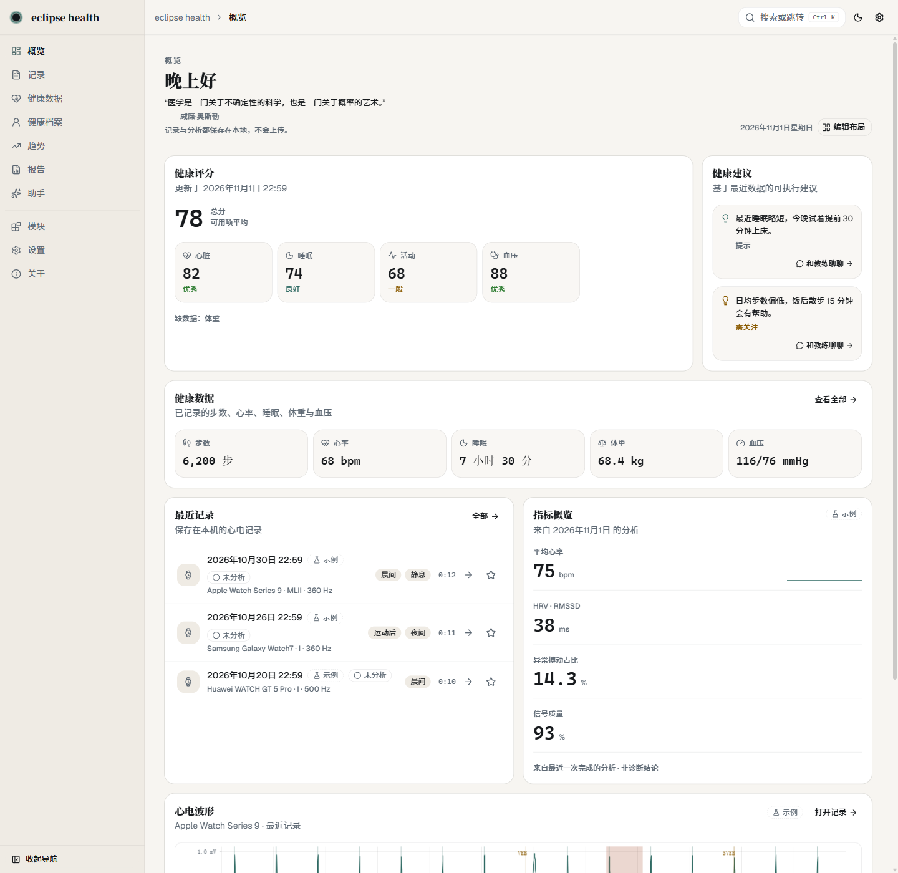
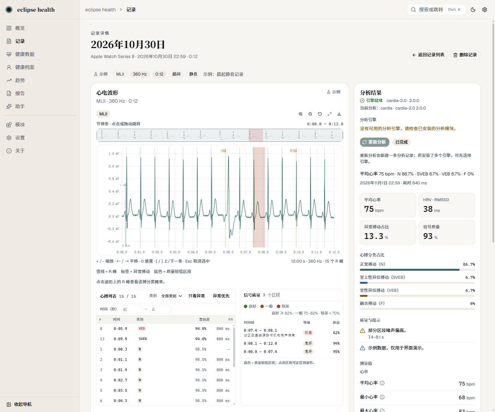
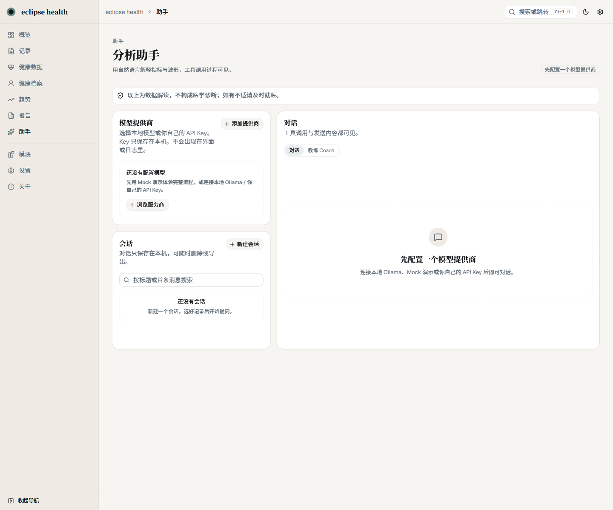
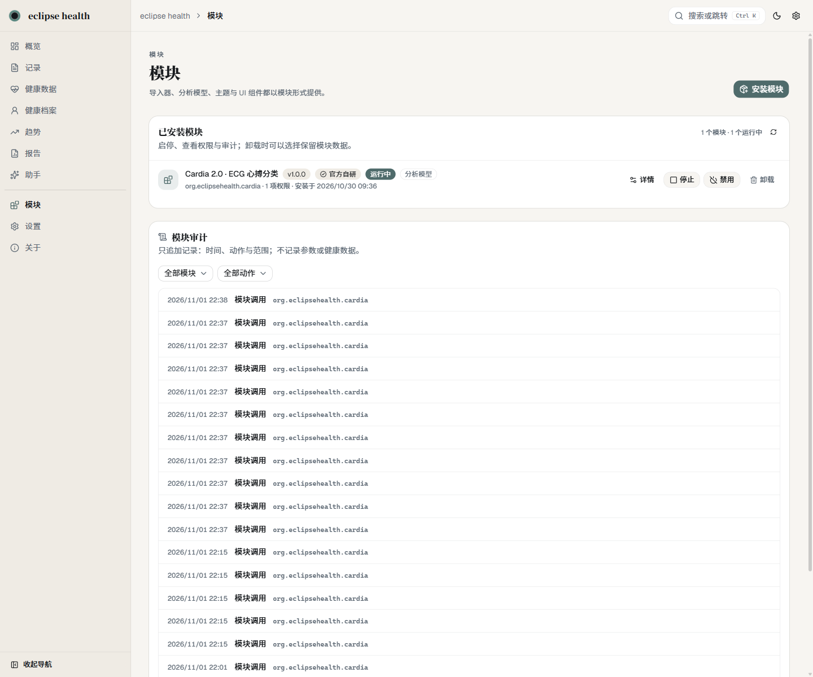
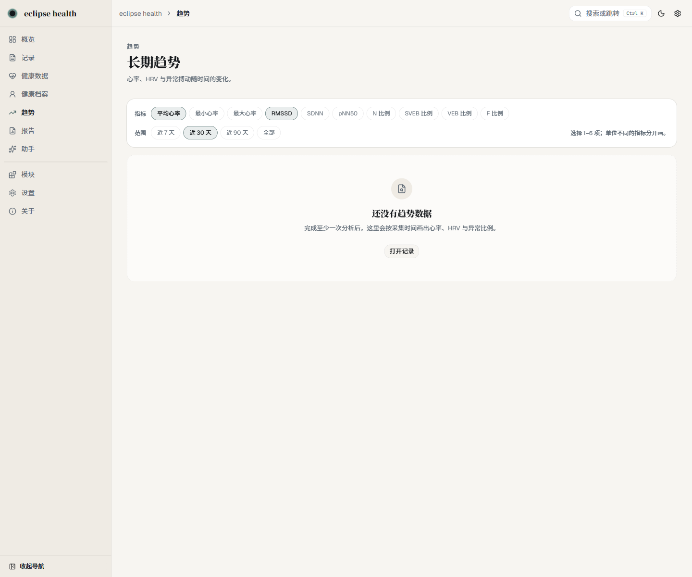
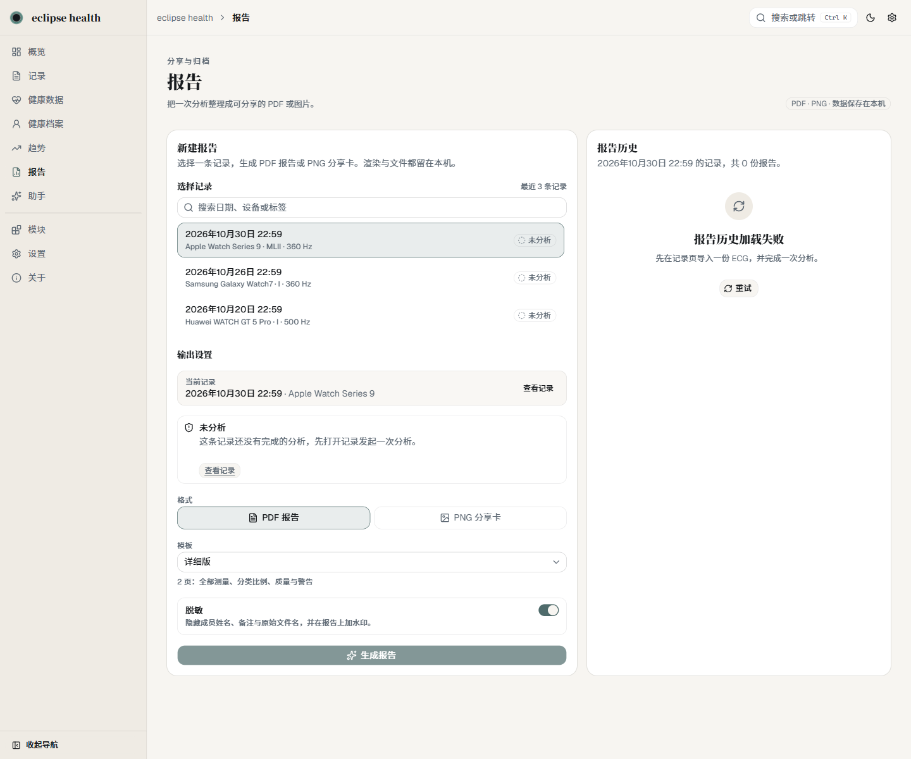
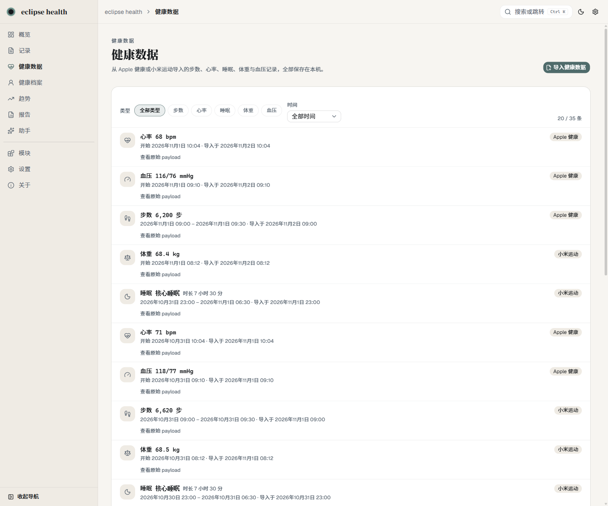
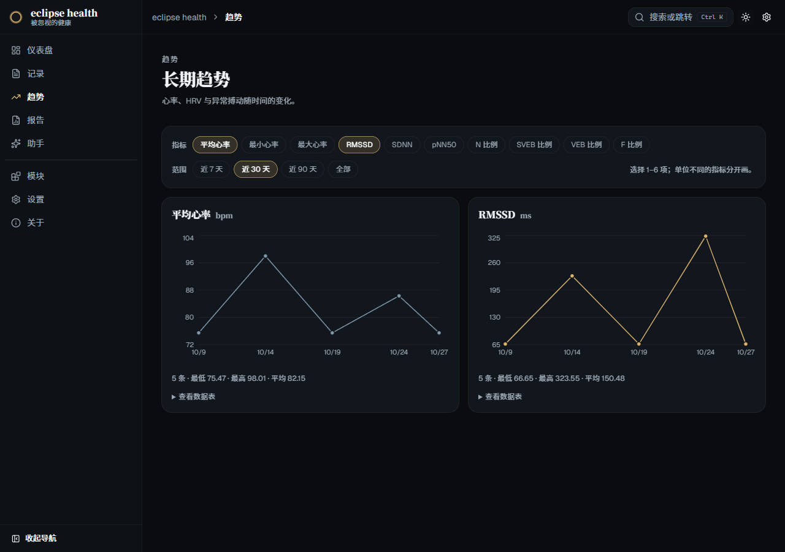

<div align="center">


# eclipse health · 被忽视的健康

**你的健康数据，由你自己保管。**

本地优先、开源开放的桌面健康中枢：心电分析、健康数据趋势与报告导出，全部在本机完成。

[](LICENSE)
[](#安装)
[](https://github.com/Muhan-Qiu/eclipse-health/releases)
[](#隐私与安全)

[官网](https://eclipse-health.fit/) · [模块市场](https://eclipse-health.fit/modules.html) · [开发者文档](https://eclipse-health.fit/developers.html) · [English](README.md)

</div>

---

> **当前状态：`0.1.0-alpha`。** 仅支持 Windows 10/11 x64。安装包未做代码签名，SmartScreen 会提示「未知发布者」，选择 **更多信息 → 仍要运行** 即可。厂商手表格式在真机导出验证前标记为 *experimental*。详见[已知限制](#已知限制)。

## 为什么选 eclipse health

大多数健康应用要求你交出数据，并信任一个黑盒。eclipse health 的立场相反：

| | 常见云端健康应用 | eclipse health |
|---|---|---|
| **数据位置** | 厂商云端 | 你的磁盘 —— 本地 SQLite + 文件，无遥测 |
| **AI 助手** | 黑盒、服务端、强制使用 | 可选，自带模型厂商（OpenAI / Anthropic / Ollama），每次工具调用可见 |
| **分析引擎** | 固定 | 可替换模块 —— 官方与第三方同一套契约 |
| **导入 / 导出** | 格式锁定 | WFDB、EDF、SCP-ECG、CSV、Apple/Samsung/华为导出；支持原始数据导出 |
| **账号** | 必须注册 | 不需要 |
| **源码** | 专有 | GPL-3.0-only，模块市场规范公开 |

### 每个数字都可追溯

可选 AI 助手回答问题时不会凭空生成数值：它调用本地工具，工具调用过程直接显示在界面上。问「我这个月 HRV 怎么变化的」，你能看到它读了哪些记录、用了哪些测量值。

### 模块化不是口号

核心刻意保持最小：数据、权限、生命周期、审计。设备适配、分析引擎、健康领域、UI 组件、导出器和 AI 工具全部是模块。官方功能也以模块形式发布 —— 预装，但可卸载、可替换。

- 模块通过 **stdio JSON-RPC** 在**独立进程**中运行，不 import 核心代码。
- 每个模块有**独立 Python venv**，依赖互相隔离。
- 权限逐项授权；**升级新增权限必须重新确认**。
- 市场索引 **Ed25519 签名**，包 **SHA-256 校验**，上架前自动扫描。

## 界面截图

| 概览 | 记录详情 + 心搏分析 |
|---|---|
|  |  |

| 可见工具调用的 AI 助手 | 模块市场 |
|---|---|
|  |  |

| 趋势 | 报告 |
|---|---|
|  |  |

| 健康数据 | 暗色主题 |
|---|---|
|  |  |

## 功能

- **心电导入** —— WFDB（`.hea`/`.dat`/`.atr`）、CSV、EDF、SCP-ECG，以及 Apple 健康心电图 CSV、Samsung、华为手表导出。支持拖拽、格式自动探测与导入前预览。
- **心搏分析** —— 内置 **Cardia 2.0** ONNX 引擎：信号质量、R 峰、逐搏 N / SVEB / VEB / F 分类、心率与间期测量。可切换引擎重新分析。
- **健康数据** —— 导入 Apple 健康导出与小米运动 CSV：步数、心率、睡眠、体重、血压。可筛选、翻页并查看原始 payload。
- **记录** —— 记录库支持时间/设备/标签筛选、收藏、波形缩放与导联切换、软删除。
- **趋势与对比** —— 指标随时间变化；两条记录并排对比。
- **报告** —— 本地生成 PDF / PNG 报告，支持脱敏与「非诊断结论」水印。
- **概览与评分** —— 综合健康评分（心脏/睡眠/体重/活动/血压）、规则建议、可拖拽布局编辑器。
- **AI 助手（可选）** —— OpenAI、Anthropic、本地 Ollama 或任意 OpenAI 兼容端点。API Key 使用 Windows DPAPI 加密。只发送摘要与测量值，不发送波形、备注或成员姓名；工具调用可见。
- **教练与记忆** —— 睡眠/心脏/运动/压力/体重预设、Open-Meteo 天气、可关闭的个人记忆。
- **主题与动效** —— 8 套主题（莫奈风格 + 高饱和 + 玻璃）、启动日食动画、涟漪 logo，遵循「减少动画」。
- **对外 API** —— 本地 REST/OpenAPI、OpenAI 兼容端点与 stdio MCP，使用设置页创建的 API Key，仅绑定本机。
- **数据管理** —— ZIP / JSON / CSV 备份与恢复、隐私清理、诊断日志导出。

## 模块生态

三个安装入口，同一套校验：

- **官方索引** —— 由项目维护并签名。包含官方模块，以及通过自动扫描的社区模块。
- **社区索引** —— 独立维护并签名。允许专有或付费模块，并显著标注。
- **本地 `.ehmod`** —— 离线或内网直接安装。

安装前校验路径安全、校验和与 manifest；风险等级与权限始终先展示。红色扫描结果拒绝安装，黄色/橙色允许但明确标注。

想开发模块？从 [`docs/MODULE_DEVELOPER_GUIDE_V1.md`](docs/MODULE_DEVELOPER_GUIDE_V1.md)、[`docs/MODULE_CONTRACT_V2.md`](docs/MODULE_CONTRACT_V2.md) 和 [`marketplace/CONTRIBUTING.md`](marketplace/CONTRIBUTING.md) 开始。

## 安装

1. 从 [Releases](https://github.com/Muhan-Qiu/eclipse-health/releases) 下载最新的 Windows 安装包（`*-x64-setup.exe`）。
2. 用发布说明里的 SHA-256 校验文件。
3. 运行安装包，启动 **eclipse health**。
4. Python 后端 sidecar 会自动在 `127.0.0.1:8765` 启动，无需额外安装。

- **系统要求：** Windows 10/11 x64。
- **未签名安装包：** SmartScreen 会提示，选择 **更多信息 → 仍要运行**。
- **数据位置：** `%LOCALAPPDATA%\eclipse-health\`（可用 `EH_DATA_DIR` 覆盖）。卸载不会删除数据。

## 从源码运行

需要 Node.js 20.19+、Python 3.12，以及 [`uv`](https://docs.astral.sh/uv/)（锁文件为 `backend/uv.lock`）。

```powershell
# 后端
cd backend
uv sync
uv run uvicorn eclipse_health_backend.app:app --host 127.0.0.1 --port 8765

# Web 预览（另一个终端，项目根目录）
npm install
npm run dev                 # http://localhost:1420

# 桌面端开发（Tauri 自动拉起后端）
npm run tauri dev
```

检查：

```powershell
npm run build                                        # tsc + vite build
cd backend
uv run pytest tests -q
uv run ruff check .
```

打包细节见 [`BUILD.md`](BUILD.md)。

## 隐私与安全

- 记录、波形、分析与报告保存在本地 SQLite 和文件目录，**不上传、无遥测**。
- 删除记录先软删除；需要彻底移除时到「隐私 → 清空数据」，会删除记录、波形、分析与报告。
- 导入只保存文件哈希，不保留原始文件名。
- AI 助手默认关闭；启用后只发送摘要、测量、质量与警告。
- 对外 API Key 只显示一次、以哈希存储；API 仅绑定本机。

## 已知限制

这是 alpha 测试版：会有未发现的 bug，界面和功能都可能变化。

- **仍会不断发现未知 bug。** 尝试新导入或新模块前请先备份数据。
- **部分数据无法读取。** Apple 健康、Samsung、华为等厂商导出标记为 *experimental*；不同手机/系统版本和导出方式可能解析失败，失败时请保留原始文件。
- **Python 与依赖库版本会影响部分功能。** 打包版自带 Python，但从源码运行、安装模块或重新导出模型时，环境差异可能导致行为不同。
- **模块没有经过完整测试。** 安装成功不代表模块可用，功能不保证。
- **核心心电分析是最稳定的路径。** 心电导入 + Cardia 2.0 心搏分析通常可用。
- **自动更新未启用**，需要手动安装新版本。
- **目前仅 Windows**。
- **仅内置一个分析引擎（Cardia 2.0）**。第三方引擎以模块安装，ONNX loader 已就绪。
- **安装包未签名**，SmartScreen 提示属预期行为。
- **AI 输出不是医疗建议**。本软件不是医疗器械，也不提供诊断。

## 路线图

近期：用正式签名构建替换 alpha 安装包、用真实导出验证厂商格式、补英文开发者文档、发布 macOS 版本。自动更新需要签名私钥与更新服务器，启用前不会伪装成已有功能。

想法与讨论请到 [Discussions](https://github.com/Muhan-Qiu/eclipse-health/discussions)，或直接开 issue。

## 参与贡献

- 模块作者：[`docs/MODULE_DEVELOPER_GUIDE_V1.md`](docs/MODULE_DEVELOPER_GUIDE_V1.md) 与 [`marketplace/CONTRIBUTING.md`](marketplace/CONTRIBUTING.md)。
- 核心贡献：先读 [`BUILD.md`](BUILD.md)，跑通上面的检查，再向 `main` 提 PR。
- Bug 与功能建议：使用 issue 模板。
- 安全问题：见 [`SECURITY.md`](SECURITY.md)，请不要开公开 issue。

社区模块 ID 绑定 GitHub 身份（`io.github.<owner>.<name>`）。官方索引只接受开源模块；社区索引允许专有模块，但必须明确标注。

## 许可证

核心采用 **GPL-3.0-only**，见 [`LICENSE`](LICENSE)。官方模块均为 OSI 认可的开源许可证；社区模块可能使用其他许可证，并会标注。

---

<div align="center">

**eclipse health** · *被忽视的健康*

本软件及所有模块输出均不构成医疗建议，不是医疗器械，不用于诊断、治疗，也不能替代专业医疗判断。

© 2026 eclipse health contributors

</div>
